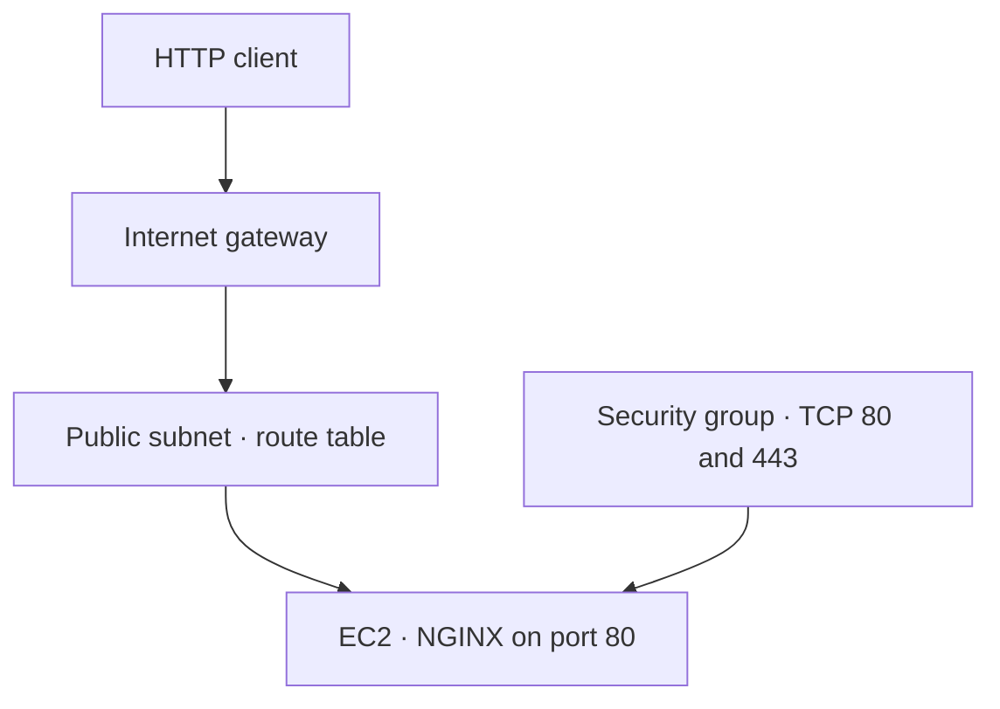

# 05 · EC2 and NGINX

Provision the public web-server lab using a custom VPC, one subnet, an internet gateway, a route table, and an EC2 instance bootstrapped with NGINX.

## Architecture



The diagram describes traffic relationships. Terraform's dependency graph is driven by references and the explicit bootstrap dependencies in [compute.tf](compute.tf).

## Configuration

| Area | Settings |
| --- | --- |
| Region / network | `us-east-1`; VPC `10.0.0.0/16`; subnet `10.0.0.0/24` |
| Instance | `t2.micro`, public IPv4 address |
| Root volume | 10 GiB `gp3`, encryption enabled, deleted on termination |
| Instance metadata | IMDSv2 tokens required |
| Bootstrap | `apt-get` installs NGINX; systemd enables and starts it |
| Inbound rules | TCP 80 and 443; no inbound SSH rule |
| Outbound rule | IPv4 egress allowed for package installation |
| Tags | Shared values merged with each resource's Name tag |

The bootstrap configures HTTP. Allowing TCP 443 in the security group does not configure an HTTPS listener or certificate.

## Choose the AMI

The learner's original file contained a fixed AMI ID. The repository makes this an explicit input to avoid presenting an aging image ID as universally usable.

```bash
cp terraform.tfvars.example terraform.tfvars
```

Replace the placeholder with a verified **Ubuntu x86_64 AMI in us-east-1**, compatible with `t2.micro` and the `apt-get` commands. The input validation checks only ID format, not the image's availability, owner, architecture, or operating system.

## Deploy and verify

Follow the [shared workflow](../docs/workflow.md) from this directory. On a fresh build, explicit dependencies keep instance creation behind the subnet route association and outbound rule required by the bootstrap.

```bash
terraform output -raw instance_id
terraform output -raw website_url
curl --fail --show-error "$(terraform output -raw website_url)"
```

Cloud-init can continue after the EC2 create operation finishes. Allow the bootstrap to finish before testing. Capture a successful HTTP response and the NGINX page; an instance in Running state alone does not verify application readiness.

## Teardown

```bash
terraform destroy
terraform state list
```

Verify the instance, lab networking, and associated root volume were removed. Keep the state used for creation until teardown is confirmed.

The supplied checklist records completion and destruction. Its wording about an NGINX AMI is historical; the supplied code installs NGINX through user data. The [review notes](../docs/review-notes.md) explain this distinction.
