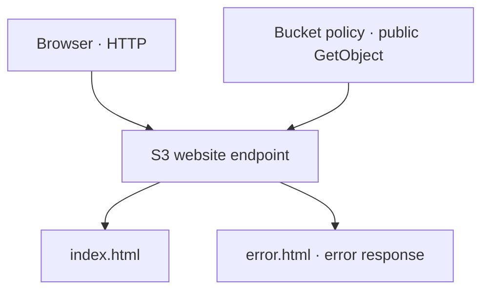

# 06 · S3 Static Website

Provision a small public static website entirely through Terraform: bucket, access settings, bucket policy, website configuration, HTML objects, and URL outputs.

## Request path



## Configuration

| Resource | Responsibility |
| --- | --- |
| `random_id.bucket_suffix` | Four-byte suffix for the bucket naming expression |
| `aws_s3_bucket.static_website` | Stores the website objects |
| Public-access settings | Permit a public bucket policy while retaining the public-ACL protections |
| Bucket policy | Grants anonymous `s3:GetObject` on objects in this bucket |
| Website configuration | Selects `index.html` and `error.html` |
| S3 objects | Upload HTML from [build/index.html](build/index.html) and [build/error.html](build/error.html) |

The objects have `text/html` content types. `filemd5()` supplies a checksum so content changes can trigger an object update. Source paths are anchored to the module directory.

The public policy explicitly depends on the public-access settings. That gives Terraform an ordering relationship beyond the shared bucket reference.

## Deploy

Use the [shared workflow](../docs/workflow.md). This learning site intentionally serves public content. Account or organization Block Public Access controls can still prevent public access even when the bucket settings permit it; inspect the applicable controls if AWS rejects the policy.

## Verify

```bash
terraform output -raw website_url
curl --fail --show-error "$(terraform output -raw website_url)"
curl --include "$(terraform output -raw website_url)/missing-page"
```

The root should return the index page. The missing path should demonstrate the configured HTML error document; the error response is expected to retain an error HTTP status, rather than becoming a successful page response.

Direct S3 website endpoints use **HTTP**. They do not support HTTPS. A future HTTPS design would use an appropriate delivery layer, such as CloudFront, with its origin/access design chosen deliberately.

## Teardown

```bash
terraform destroy
terraform state list
```

Terraform owns both uploaded objects and can remove them during destruction. This does not justify deleting unrelated content added outside the exercise. If additional objects prevent bucket deletion, inspect them and remove only data deliberately created for the lab.

The learner confirmed the original site worked and was destroyed. The published snapshot includes the small maintenance changes listed in the [review notes](../docs/review-notes.md); those changes are not represented as a fresh AWS deployment.

[AWS website endpoint reference](https://docs.aws.amazon.com/AmazonS3/latest/userguide/WebsiteEndpoints.html) · [Evidence scope](../docs/verification.md)
