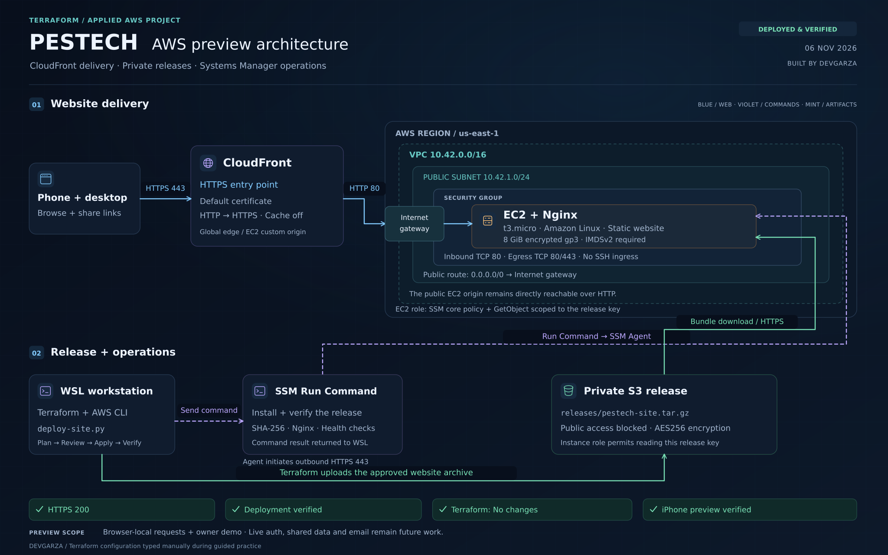

# Pestech Preview · Terraform on AWS

**Ivan Garza · [devgarza-ai](https://github.com/devgarza-ai) · Deployed November 6, 2026**

A temporary website preview for a family pest-control business, provisioned with Terraform and delivered through CloudFront to Nginx on EC2. The release archive lives in private S3; a Python helper deploys it through AWS Systems Manager Run Command and verifies the installation.

I manually typed the Terraform configuration in WSL during guided practice, reviewed the execution plans, applied the infrastructure, deployed the release, and checked the result on desktop and phone. Website assets, the Python deployment helper, and this portfolio documentation were prepared with AI assistance. This is a hands-on learning project with a working AWS deployment.

**Deployment status:** verified on AWS. **Source publication:** all seven learner-uploaded Terraform files, the original provider lock file, bootstrap, and deployment helper are included. Publication normalized filenames and Terraform formatting while preserving resource attribute values and lock-file bytes. A deployment also requires the approved website archive, which is supplied separately and kept out of Git.

[Desktop SVG](docs/Pestech_AWS_Architecture_Desktop.svg) · [Mobile SVG](docs/Pestech_AWS_Architecture_Mobile.svg) · [Architecture notes](docs/architecture.md) · [Deployment workflow](docs/operations.md) · [Verified results](docs/verification.md)

## What I accomplished

- Built the preview's AWS network with a VPC, public subnet, internet gateway, public route table, and security-group rules.
- Configured an EC2 `t3.micro` web server with an encrypted gp3 root volume, required IMDSv2, and Nginx bootstrapping.
- Attached an instance role for Systems Manager and scoped `s3:GetObject` access to the website release object.
- Uploaded the approved archive to private S3 with public access blocked and AES256 object encryption.
- Deployed through SSM without opening SSH ingress; checked the archive's SHA-256, Nginx configuration, health endpoint, pages, and assets.
- Added CloudFront with a default CloudFront certificate, HTTP-to-HTTPS redirect for viewers, and disabled caching during review.
- Verified the public HTTPS homepage, owner demo, share image, and deployed motion files.
- Confirmed the original PESTECH-only wordmark in an actual iPhone Messages link preview.
- Finished with a Terraform plan reporting no pending changes.

## Architecture at a glance

| Flow | Implementation |
| --- | --- |
| Visitor requests | Browser → HTTPS/443 → CloudFront → HTTP/80 → EC2/Nginx through public VPC routing |
| Infrastructure changes | WSL Terraform → reviewed plan → AWS resources |
| Release upload | Terraform → private S3 object at `releases/pestech-site.tar.gz` |
| Release installation | Python helper → SSM Run Command → SSM Agent on EC2 → approved bundle download from S3 |
| Authorization | Instance profile, SSM managed policy, and S3 read permission scoped to the release key |

CloudFront is a global edge service. EC2 and the release bucket are in `us-east-1`. The instance is in VPC `10.42.0.0/16`, public subnet `10.42.1.0/24`. S3 is an artifact store for this deployment; the website's CloudFront custom origin is EC2.

## Preview link and scope

Terraform generates the temporary HTTPS address through the `https_preview_url` output. It is shared directly for the family review; the deployment-specific address is omitted from this public source snapshot.

The address is a temporary deployment endpoint and may be retired after review. The website and owner workspace remain frontend demonstrations with browser-local records. Live authentication, a shared customer database, email delivery, and live AI are future implementation work. This preview does not claim high availability or production readiness.

The CloudFront-to-origin connection uses HTTP, and the public EC2 origin remains directly reachable on port 80. Viewer HTTPS and private artifact storage do not imply origin isolation or encryption on every hop. The diagram records that deployed boundary explicitly.

## Files

| Path | Purpose |
| --- | --- |
| `providers.tf` | Terraform 1.17.1 constraint, AWS provider, Region and default tags |
| `networking.tf` | VPC, public subnet, internet gateway and routing |
| `security.tf` | Web ingress and HTTP/HTTPS egress rules |
| `iam.tf` | EC2 trust policy, SSM attachment and instance profile |
| `compute.tf` | Amazon Linux AMI lookup, EC2 settings and initial outputs |
| `assets.tf` | Private S3 release object, checksum and scoped object-read policy |
| `cloudfront.tf` | CloudFront HTTPS entry point and public output |
| `.terraform.lock.hcl` | Learner-supplied AWS provider 6.72.0 selection and checksums |
| `user-data.sh` | Learner-uploaded EC2 bootstrap and Nginx configuration |
| `deploy-site.py` | AI-assisted SSM deployment helper paired to the approved release checksum |
| `pestech-site.tar.gz.sha256` | SHA-256 of the verified release; the website archive is supplied separately |
| `docs/` | Architecture SVG, explanation, operations, and deployment evidence |

Keep state, saved plans, AWS credentials, local configuration, release archives, and deployment receipts outside Git. The repository's ignore rules and publication checks protect the common generated filenames. [Source provenance](docs/source-files.json) records the uploaded and published hashes. [Publication review](docs/publication-review.md) records the sensitive-data checks and exclusions.

## Configuration checks

Use Terraform 1.17.1 for this root. CI checks formatting, initializes without an AWS backend using the supplied lock file, and validates the configuration without AWS credentials. It creates an ephemeral empty archive only so `filesha256()` has an input during configuration checks; this fixture is not the approved website release and is never deployed.

## Learning outcomes

This project connects resource references, dependency order, networking, IAM instance permissions, bootstrapping, artifact delivery, and post-deployment verification. The final clean plan checks Terraform-managed infrastructure; the separate HTTP and deployment checks establish that the application files are being served.
