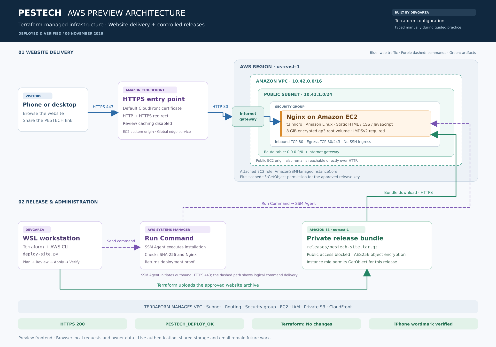

# Architecture Notes

[Save the architecture SVG](Pestech_Preview_AWS_Architecture.svg)

The diagram describes the preview deployed and verified on November 6, 2026, Pacific time. It includes the actual delivery and deployment paths, plus the network and application boundaries established by the supplied configuration, execution plans, terminal evidence, HTTP checks, and phone screenshot.

## Website delivery

1. A visitor opens the CloudFront-generated HTTPS address.
2. CloudFront provides its default certificate and redirects HTTP viewer requests to HTTPS. Its review cache policy is disabled.
3. CloudFront forwards requests to the instance's public DNS name using HTTP port 80.
4. The internet gateway, public route table, and security group provide the path to the public subnet.
5. Nginx serves the static website from `/usr/share/nginx/html`, including directory routes and the PESTECH sharing image.

| Component | Deployed role |
| --- | --- |
| VPC | `10.42.0.0/16`, DNS support and DNS hostnames enabled |
| Public subnet | `10.42.1.0/24`, public IPv4 assignment |
| Internet gateway and route table | Public subnet route `0.0.0.0/0` through the internet gateway |
| Security group | Inbound TCP 80; outbound TCP 80/443; no SSH ingress rule in the supplied plan |
| EC2 | `t3.micro`, Amazon Linux, 8 GiB encrypted gp3 root volume, required IMDSv2 |
| Nginx | Static directory serving, `/healthz`, MIME types, gzip, dotfile denial, and preview `noindex` headers |
| CloudFront | Global edge service, EC2 custom origin, viewer HTTPS redirect, default certificate, review caching disabled |

## Release deployment

Terraform uploads `pestech-site.tar.gz` to the private release bucket at `releases/pestech-site.tar.gz`. The object uses AES256 server-side encryption, and Terraform detects archive changes using SHA-256.

The developer invokes `deploy-site.py` from the existing Terraform working directory. It reads the outputs, validates the instance ID and approved artifact digest, and sends an `AWS-RunShellScript` command through SSM. The instance downloads the archive with its role, verifies its checksum, extracts it, sets share-image metadata to the applied public origin, tests and reloads Nginx, and checks the local health/page/asset responses. The helper returns `PESTECH_DEPLOY_OK` only after those checks pass.

The role has `AmazonSSMManagedInstanceCore` and an additional policy granting `s3:GetObject` on the specific release object. The SSM Agent initiates outbound service connections over HTTPS. The diagram's dashed command arrow is a logical control flow, not an inbound listener or an SSH connection.

## Diagram boundaries

- CloudFront is outside the regional VPC; SSM and S3 service cards are also outside the subnet.
- The EC2 role is attached through an instance profile; IAM is not hosted inside a subnet.
- The public EC2 origin remains reachable directly over HTTP. CloudFront origin-only access is not implemented in this preview.
- Viewer-to-CloudFront traffic uses HTTPS; CloudFront-to-EC2 traffic uses HTTP.
- The application has browser-local demo records. No deployed database, email pipeline, user authentication, load balancer, container platform, custom domain, or production AI service is shown.

## Reference documentation

- [Systems Manager network connectivity](https://docs.aws.amazon.com/systems-manager/latest/userguide/setup-create-vpc.html)
- [CloudFront custom-origin HTTPS policy](https://docs.aws.amazon.com/AmazonCloudFront/latest/DeveloperGuide/using-https-cloudfront-to-custom-origin.html)
- [Terraform plan behavior](https://developer.hashicorp.com/terraform/cli/commands/plan)

These references explain service behavior. The evidence ledger records what was actually observed for this project.
